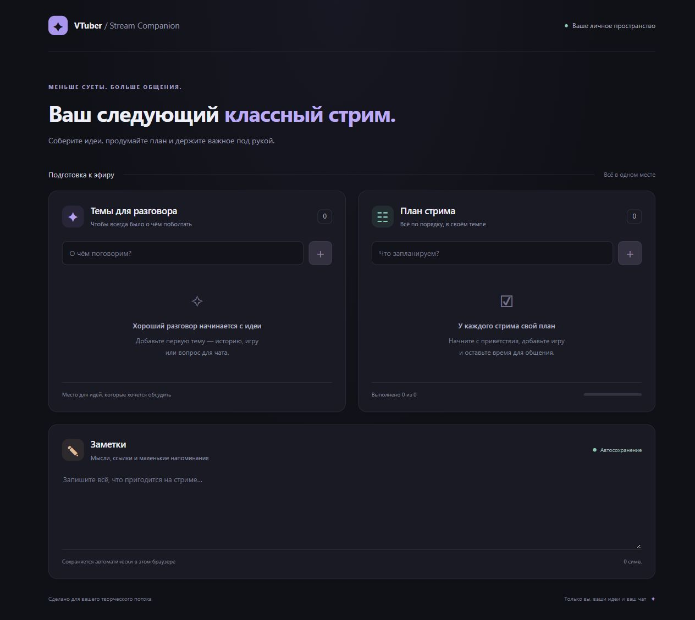

# VTuber Stream Companion

Локальное приложение на Vue 3, TypeScript и Vite. Три раздела: темы для разговора, план стрима и заметки. Интерфейс на русском языке, адаптивная тёмная тема. Backend, авторизация, платные API и внешние шрифты не используются.

[Открыть приложение](https://miyamon.github.io/vtuber-stream-companion/)



## Запуск

Нужен Node.js 24 LTS и pnpm 11.25.0. Установка pnpm: `npm install --global pnpm@11.25.0`.

```powershell
git clone https://github.com/miyamon/vtuber-stream-companion.git
cd vtuber-stream-companion
pnpm install --frozen-lockfile
pnpm run dev
```

Откройте адрес, который напечатает Vite (обычно http://127.0.0.1:5173/). Для остановки нажмите Ctrl+C в терминале.

Для проверки типов и production-сборки:

```powershell
pnpm run typecheck
pnpm run build
pnpm run preview
```

Команда `build` также проверяет типы. Сборка находится в `dist/`; её нужно открывать через HTTP-сервер, например `preview`, а не двойным щелчком по HTML.

## GitHub Pages

Workflow `.github/workflows/deploy.yml` устанавливает зависимости из lock-файла, проверяет TypeScript, собирает приложение и публикует `dist/` при push в `main`. Для pull request выполняется только проверка сборки. Публикацию также можно запустить вручную через Actions → Deploy to GitHub Pages → Run workflow.

В Settings → Pages выбран источник GitHub Actions. Относительный `base` в Vite позволяет загружать ресурсы из подпапки репозитория. Данные в браузере остаются локальными и не попадают в GitHub.

## Стиль кода

Правила отступов заданы в `.editorconfig`, форматирования — в `.prettierrc.json`. Форматтер не добавлен в зависимости приложения. При необходимости его можно запустить разово:

```sh
npm exec --yes --package=prettier@3.6.2 -- prettier --write src vite.config.ts package.json "tsconfig*.json" index.html README.md .github .prettierrc.json
```

## Что находится в проекте

| Файл                                   | Назначение                                                         |
| -------------------------------------- | ------------------------------------------------------------------ |
| `index.html`                           | HTML-страница с русской локалью и точкой подключения приложения    |
| `src/main.ts`                          | Создаёт приложение Vue и подключает CSS                            |
| `src/App.vue`                          | Общая разметка и три компонента разделов                           |
| `src/components/TopicsSection.vue`     | Ввод, добавление и удаление тем                                    |
| `src/components/StreamPlanSection.vue` | Задачи, чекбоксы, удаление и прогресс                              |
| `src/components/NotesSection.vue`      | Заметки, автосохранение и счётчик символов                         |
| `src/composables/useLocalStorage.ts`   | Чтение, проверка и сохранение данных, сообщения об ошибках         |
| `src/types.ts`                         | Типы тем и задач, проверки загруженных данных                      |
| `src/style.css`                        | Тёмная тема, карточки, фокус клавиатуры, адаптация к узкому экрану |
| `src/vite-env.d.ts`                    | Типы окружения Vite                                                |
| `vite.config.ts`                       | Подключение Vue к Vite                                             |
| `tsconfig*.json`                       | Строгие настройки TypeScript для приложения и конфигурации         |
| `package.json`                         | Необходимые зависимости и команды                                  |
| `pnpm-lock.yaml`                       | Зафиксированные версии зависимостей для pnpm                       |
| `pnpm-workspace.yaml`                  | Разрешение служебной сборки esbuild для pnpm                       |
| `.gitignore`                           | Исключает зависимости, сборку и временные файлы TypeScript         |
| `.github/workflows/deploy.yml`         | Проверка сборки и публикация на GitHub Pages                       |
| `.editorconfig`, `.prettierrc.json`    | Общие правила оформления кода                                      |
| `.gitattributes`                       | Единые окончания строк в Git                                       |

## Как устроен Composition API

Компоненты используют `<script setup lang="ts">`. `ref` хранит реактивное состояние, `v-model` связывает его с полями и чекбоксами. `computed` пересчитывает количество выполненных задач и прогресс. `watch` в `useLocalStorage` следит в том числе за вложенными изменениями, например `task.done`, и сразу сохраняет JSON. Одна функция сохранения используется всеми тремя разделами.

Данные сохраняются под ключами `vtuber-companion:topics`, `vtuber-companion:tasks`, `vtuber-companion:notes`. Они принадлежат конкретному браузеру и адресу приложения: `localhost` и `127.0.0.1`, а также разные порты имеют отдельные хранилища. Очистка данных сайта удаляет сохранённые записи. Синхронизация между устройствами и открытыми вкладками не предусмотрена.

## Ручная проверка

1. **Темы:** введите тему и нажмите `+` или Enter. Она должна появиться в списке. Нажмите `×`: тема исчезнет, счётчик уменьшится. Пустой ввод и пробелы не должны добавляться.
2. **План:** добавьте две задачи. Отметьте одну — появится зачёркивание и прогресс 50%, подпись «Выполнено 1 из 2». Снимите отметку и проверьте обратное изменение. Удалите задачу кнопкой `×`.
3. **Заметки:** введите несколько строк, перезагрузите страницу — текст должен остаться. Очистите поле и снова перезагрузите: оно должно остаться пустым.
4. **Сохранение списков:** добавьте тему и отмеченную задачу, перезагрузите страницу. Записи и отметка должны восстановиться. Удалённые записи после перезагрузки не возвращаются.
5. **Клавиатура и экран:** переходите по полям и кнопкам через Tab, переключайте чекбокс пробелом. На узком экране карточки располагаются в один столбец.

## Выполненная проверка

Проверка типов `vue-tsc -b` и production-сборка Vite прошли успешно. В браузере проверены добавление тем и задач, переключение задачи, восстановление всех данных после перезагрузки, удаление записей, сохранение пустых заметок и блокировка темы из пробелов. Тестовые записи после проверки удалены.
